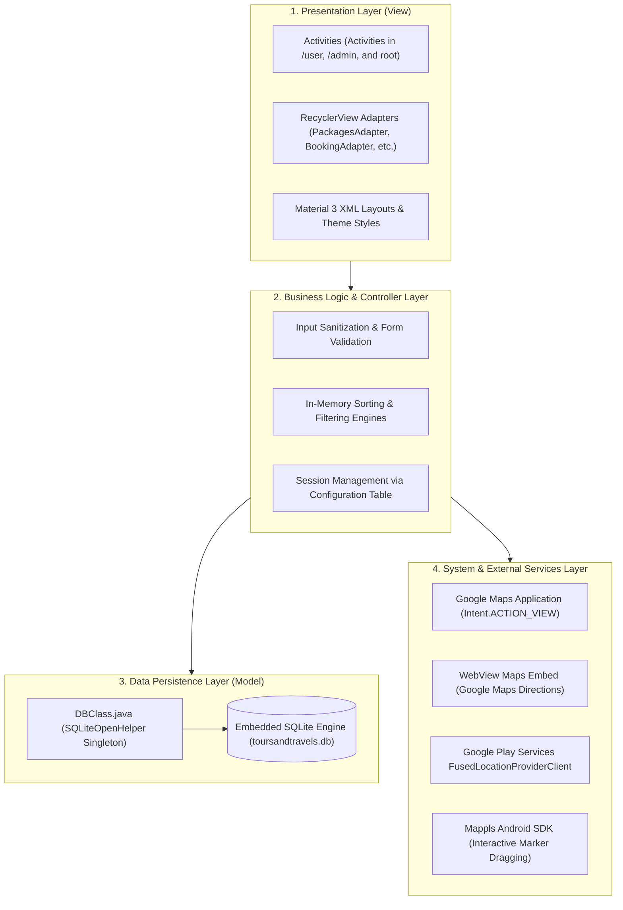
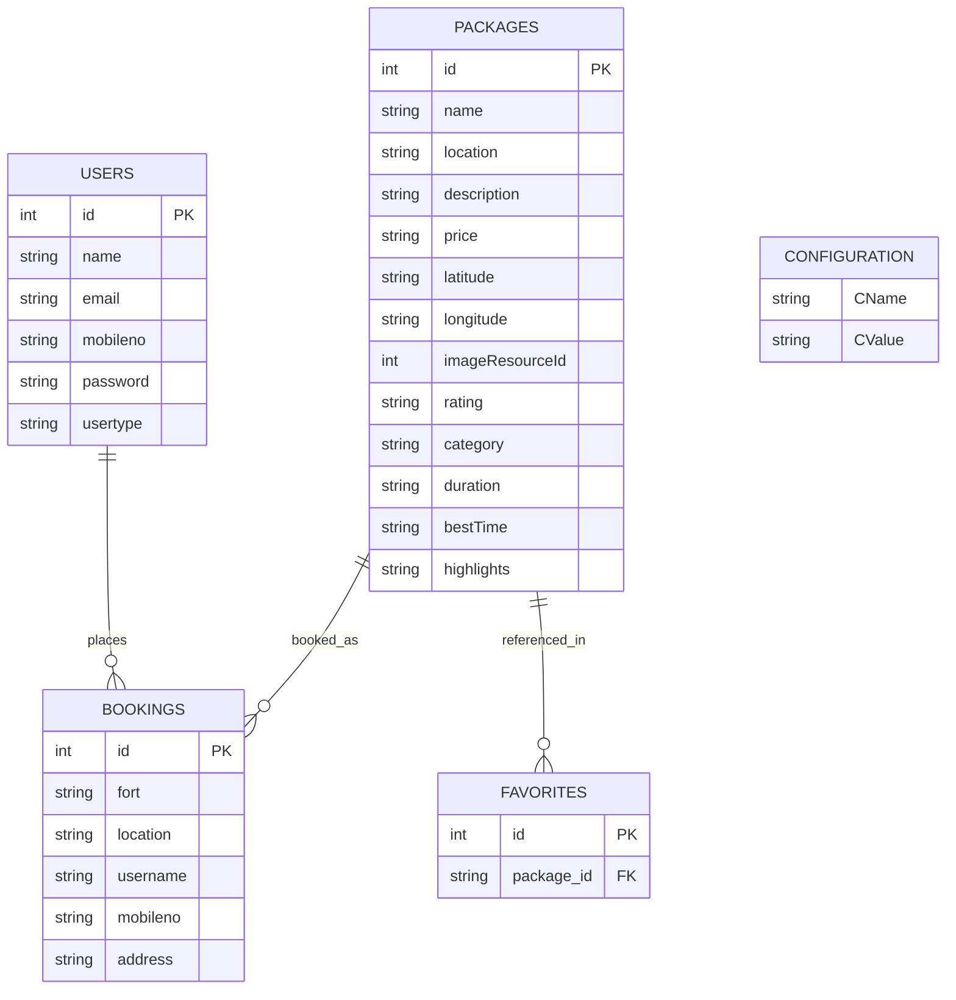

# 📘 ToursAndTravels — Technical Architecture & Project Information

This document provides in-depth architectural specifications, entity-relationship diagrams, interaction flows, and developer guidance for the **ToursAndTravels** Android application.

---

## 🏛️ 1. Architecture & Design Patterns

The application follows an **Offline-First MVC / Layered Architecture** optimized for native Android applications.



---

## 🗃️ 2. Entity-Relationship (ER) Diagram



---

## 🔄 3. Core Interaction Sequences

### 3.1 Traveler Discovery & Booking Sequence
```mermaid
sequenceDiagram
    autonumber
    actor Traveler
    participant Home as UserHomeActivity
    participant Catalog as FindPackagesActivity
    participant Details as PackagesDetailsActivity
    participant DB as DBClass (SQLite)
    participant BookingAct as AddBookingsActivity
    participant MyBkg as MyBookings

    Traveler->>Home: Tap City Chip (e.g. Jaipur)
    Home->>Catalog: Intent with city="Jaipur"
    Catalog->>DB: findPackages("Jaipur", lat, lon)
    DB-->>Catalog: Return Cursor of Jaipur Packages
    Catalog-->>Traveler: Render Staggered Cards (Hawa Mahal, Amber Palace)
    
    Traveler->>Catalog: Tap "Amber Palace & Jal Mahal"
    Catalog->>Details: Intent with Package Metadata & Coordinates
    Details->>DB: isFavorite(packageId)
    DB-->>Details: Return bookmark status (true/false)
    Details-->>Traveler: Render Hero Photo, Ratings, Inclusions, Map Preview
    
    Traveler->>Details: Tap "Book Tour"
    Details->>BookingAct: Intent with package title & city
    Traveler->>BookingAct: Enter traveler name, phone, address & Submit
    BookingAct->>DB: addBooking(title, city, name, phone, address)
    DB-->>BookingAct: Success (Row ID)
    BookingAct->>MyBkg: Launch My Bookings
    MyBkg->>DB: getBookings()
    DB-->>MyBkg: Return Cursor of Confirmed Trips
    MyBkg-->>Traveler: Display Confirmed Itinerary Card
```

---

## 🧩 4. Component Inventory

### 4.1 Root Activities
- `SplashScreenActivity`: Checks active session in `Configuration` table and smoothly animates to `UserHomeActivity`, `AdminHomeActivity`, or `LoginActivity`.
- `LoginActivity`: Authenticates email and password against `users` table via `DBClass.loginUser()`.
- `RegistrationActivity`: Registers new traveler accounts into `users` table with client-side field validation.
- `MainActivity`: Secondary entry/router activity.

### 4.2 Traveler Activities (`com.example.toursandtravels.user`)
- `UserHomeActivity`: Traveler dashboard containing auto-advancing `ImageSlider` and 6 quick-navigation city chips (`All`, `Mumbai`, `Jaipur`, `Goa`, `Pune`, `Udaipur`).
- `PackageFilterActivity`: Targeted search form allowing travelers to input custom destination keywords.
- `FindPackagesActivity`: Core discovery screen featuring dynamic `TextWatcher` live search, chips for **All**, **Saved**, **Price Low-High**, **Price High-Low**, and **Top Rated**, bound via `PackagesAdapter`.
- `PackagesDetailsActivity`: Comprehensive landmark details screen featuring high-res imagery, rating badges, duration, inclusions, best season, favorite toggle, WebView map embed, and external Google Maps navigation intent.
- `AddBookingsActivity`: Guided tour reservation form capturing customer contact information.
- `MyBookings`: List of reserved tours for the current traveler, with support for itinerary cancellation.
- `MyProfileActivity`: Traveler profile editor allowing instant updates to user contact details.

### 4.3 Administrator Activities (`com.example.toursandtravels.admin`)
- `AdminHomeActivity`: Administrative control dashboard with quick action cards.
- `AddPackageActivity`: Form for publishing new tourist packages into the SQLite catalog.
- `AddPackagesActivity`: Grid management view showing all active packages with deletion controls.
- `MarkerDraggingActivity`: Visual map interface leveraging Mappls SDK for dragging pins to pinpoint GPS coordinates.
- `AppUsersActivity`: Traveler account directory displaying all registered platform users.
- `ViewAllBookings`: Master oversight log listing all tour bookings across all travelers and cities.

### 4.4 Adapters & Data Models (`com.example.toursandtravels.adapters`)
- `Packages`: Data model for tourist attractions and packages.
- `PackagesAdapter`: Staggered/linear card adapter binding package photos, titles, prices, ratings, and city badges to `packages.xml`.
- `Booking`: Data model representing a confirmed tour reservation.
- `BookingAdapter`: Renders tour cards in `MyBookings` and `ViewAllBookings` with user info, destination, and cancellation listener.
- `User`: Data model representing registered application users.
- `UserAdapter`: Renders traveler cards in `AppUsersActivity`.

---

## 💡 5. Evolution from Client-Server to Offline-First

### 5.1 The Previous Prototype Limitation
Earlier prototype versions of this academic project used an external Apache/PHP/MySQL stack running via XAMPP/WAMP on a local PC (`http://192.168.x.x/toursandtravels/...`) and consumed endpoints via the Volley library.

**Challenges Encountered:**
1. Dynamic Wi-Fi router DHCP reassigned local IP addresses constantly, breaking hardcoded URLs in the Java activities.
2. College campus or mobile hotspots frequently isolated client devices (AP isolation), blocking Android emulators and phones from reaching the host PC.
3. Live project evaluations failed whenever network connectivity dropped.

### 5.2 The Modernized Offline-First Solution
In this production build:
1. All core data structures (`users`, `packages`, `favorites`, `bookings`, `Configuration`) are housed inside Android's native SQLite engine via `DBClass.java`.
2. Seed data (12 rich Indian destinations, default accounts, and sample bookings) is automatically inserted when the app runs for the first time.
3. Volley network queues are preserved as optional extensions, while all user interactions execute immediately against local storage with zero network latency.
4. Google Maps is invoked via explicit Android intents (`Intent.ACTION_VIEW`), handing off navigation rendering directly to the official Google Maps app installed on the device.

---

## 🛠️ 6. Code Style & Conventions
- **Clean Architecture Principles**: Database operations are centralized in `DBClass.java`; activities remain lightweight and focused on UI lifecycle.
- **Modern SDK Compliance**: Android 15 (SDK 35) compatible, with proper handling of WindowInsets and ActionBar back-navigation buttons.
- **Resource Management**: High-resolution drawable assets are compressed and optimized for mobile memory constraints.
