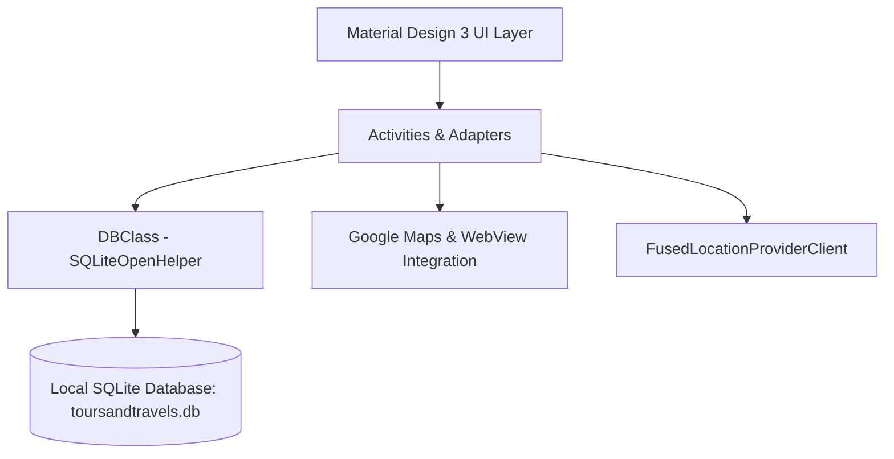

# 🌍 ToursAndTravels - Offline-First Android Travel Companion

[](https://www.android.com/)
[-34A853?style=for-the-badge&logo=android)](https://developer.android.com/about/versions/15)
[-FBBC05?style=for-the-badge&logo=android)](https://developer.android.com/about/versions/nougat)
[](https://www.oracle.com/java/)
[](https://gradle.org/)
[](https://developer.android.com/studio/releases/gradle-plugin)
[-003B57?style=for-the-badge&logo=sqlite&logoColor=white)](https://www.sqlite.org/)
[](https://m3.material.io/)

> **ToursAndTravels** is a feature-rich, offline-first native Android application developed in Java. It provides travelers with an intuitive, unified platform for discovering iconic city destinations, exploring landmark itineraries, saving preferred spots to a personal wishlist, viewing interactive route directions, and reserving tour packages—all operating seamlessly without reliance on external servers.

---

## 📌 Table of Contents

- [Overview](#-overview)
- [Key Features](#-key-features)
- [System Architecture](#-system-architecture)
- [Demo Credentials](#-demo-credentials)
- [Pre-Seeded Destinations](#-pre-seeded-destinations)
- [Tech Stack & Libraries](#-tech-stack--libraries)
- [Project Directory Structure](#-project-directory-structure)
- [Installation & Getting Started](#-installation--getting-started)
- [Screenshots & User Experience](#-screenshots--user-experience)
- [Detailed Documentation](#-detailed-documentation)
- [Contributors & Academic Credits](#-contributors--academic-credits)
- [License](#-license)

---

## 🌟 Overview

Earlier travel app prototypes often relied heavily on fragile local PHP/MySQL servers that broke whenever local IP addresses shifted or demonstration environments lacked active internet connections. 

**ToursAndTravels** solves this challenge by implementing an **offline-first SQLite persistence layer (`DBClass`)**. The database is initialized and auto-seeded out of the box with curated travel packages across major Indian cities, pre-configured traveler and administrator accounts, and sample bookings.

When connected to the internet, travelers can additionally leverage live **Google Maps route navigation** and GPS positioning. When offline, all core functions—browsing, filtering, sorting, wishlist management, booking creation, profile updates, and admin moderation—remain 100% functional.

---

## ✨ Key Features

### 👤 Traveler Experience
- **🔐 Secure Role-Based Authentication:** Clean Sign-In and Registration screens with client-side validation and persistent session state.
- **🏙️ City-Wise Exploration:** One-tap quick filter chips for major tourist hubs: **Mumbai, Jaipur, Goa, Pune, Udaipur, Agra, Delhi, and Manali**.
- **🎠 Auto-Cycling Hero Showcase:** Automated image slider on the home screen highlighting premier landmark photography.
- **🔍 Real-Time Search & Sorting:** Instant search by monument name or city, with dynamic sorting chips:
  - 💵 **Price: Low to High**
  - 💎 **Price: High to Low**
  - ⭐ **Top Rated Destinations**
  - ❤️ **Saved Wishlist Filter**
- **❤️ Interactive Wishlist (Favorites):** Save destinations with a single tap for quick access during travel planning.
- **📍 Detailed Attraction Views:** Full-screen landmark overviews including:
  - Category, duration, and pricing
  - Star ratings and curated trip highlights
  - Best season/time to visit
  - Integrated Google Maps route preview and turn-by-turn driving link
- **📅 Guided Tour Booking:** Streamlined booking flow capturing traveler contact details and pickup addresses.
- **📑 Personal Trip Management (`My Bookings`):** Review upcoming reserved tours with option to cancel or delete entries.
- **👤 Profile Management:** View and edit personal traveler account details directly from the app.

### 🛡️ Administrator Hub
- **➕ Package Management:** Create new tourist packages with custom titles, pricing, descriptions, and GPS coordinates.
- **🗺️ Coordinate Selection:** Drag and pinpoint destination markers on an interactive map.
- **👥 User Directory:** Inspect all registered app travelers.
- **📋 Master Bookings Oversight:** Monitor and manage all traveler tour reservations across every city.

---

## 🏗️ System Architecture

ToursAndTravels follows a modular, layered architecture designed for maintainability and offline resilience:



| Layer | Responsibility | Components |
|---|---|---|
| **Presentation Layer** | Renders responsive layouts, cards, chips, image sliders, and dialogs | XML Layouts, MaterialCardView, RecyclerView |
| **Controller Layer** | Handles UI events, input validation, and activity navigation | Java Activities (`UserHomeActivity`, `FindPackagesActivity`, etc.) |
| **Adapter Layer** | Binds local SQLite datasets to RecyclerView viewholders | `PackagesAdapter`, `BookingAdapter`, `UserAdapter` |
| **Data Layer** | Manages local relational tables, queries, transactions, and seeding | `DBClass` (SQLiteOpenHelper) |
| **Service Layer** | Provides device location and web route previews | Google Play Services Location, WebView |

---

## 🔑 Demo Credentials

The application comes pre-loaded with testing accounts so you can explore both roles immediately:

| Role | Email | Password | Access Level |
|---|---|---|---|
| **Administrator** | `admin@gmail.com` | `123456` | Full administrative control, add/delete packages, view all users and bookings |
| **Traveler** | `user@gmail.com` | `123456` | City exploration, search/sort, wishlist, tour booking, profile management |

*(You can also register a brand new traveler account at any time via the Registration screen.)*

---

## 📍 Pre-Seeded Destinations

The database automatically seeds curated high-resolution packages on first run:

1. **Mumbai** - *Gateway of India & Marine Drive* (Heritage, ₹1,499)
2. **Mumbai** - *Elephanta Caves Heritage Tour* (UNESCO, ₹1,899)
3. **Jaipur** - *Hawa Mahal & Pink City Walk* (Royal City, ₹1,799)
4. **Jaipur** - *Amber Palace & Jal Mahal* (Palace, ₹2,299)
5. **Goa** - *Baga Beach & Aguada Sunset* (Beach, ₹2,499)
6. **Goa** - *Old Goa Churches & Spice Farm* (Culture, ₹1,999)
7. **Pune** - *Shaniwar Wada & Dagdusheth* (Heritage, ₹999)
8. **Pune** - *Sinhagad Scenic Hilltop* (Hilltop, ₹1,199)
9. **Udaipur** - *City Palace & Lake Pichola* (Lakeside, ₹2,599)
10. **Agra** - *Taj Mahal Sunrise Experience* (Wonder, ₹2,799)
11. **Delhi** - *Red Fort & India Gate Tour* (Capital, ₹1,699)
12. **Manali** - *Solang Valley & Mall Road* (Mountains, ₹3,299)

---

## 🛠️ Tech Stack & Libraries

- **Language:** Java (JDK 17)
- **Target OS:** Android 15 (API 35)
- **Minimum OS:** Android 7.0 (API 24 - Nougat)
- **Build System:** Gradle 9.1.0 with Android Gradle Plugin (AGP) 9.0.1
- **Architecture:** Offline-First SQLite Relational Persistence
- **UI Framework:** Material Design 3, AppCompat, ConstraintLayout, CardView
- **Key Dependencies:**
  - `com.github.denzcoskun:ImageSlideshow:0.1.2` — Auto-playing hero carousel
  - `com.google.android.gms:play-services-location:21.0.1` — Device GPS location
  - `com.google.android.gms:play-services-maps:17.0.1` — Native map rendering
  - `com.mappls.sdk:mappls-android-sdk:8.1.3` — Advanced map and marker dragging
  - `com.github.QuadFlask:colorpicker:0.0.15` — Color picker utility
  - `com.android.volley:volley:1.2.1` — HTTP request queue support

---

## 📂 Project Directory Structure

```text
ToursAndTravels/
├── app/
│   ├── src/
│   │   ├── main/
│   │   │   ├── java/com/example/toursandtravels/
│   │   │   │   ├── DBClass.java                 # Central SQLiteOpenHelper & persistence logic
│   │   │   │   ├── LoginActivity.java           # Authentication handler
│   │   │   │   ├── RegistrationActivity.java    # New account registration
│   │   │   │   ├── SplashScreenActivity.java    # Animated launch screen
│   │   │   │   ├── MainActivity.java            # Landing router
│   │   │   │   ├── adapters/                    # RecyclerView adapters & models
│   │   │   │   │   ├── Booking.java
│   │   │   │   │   ├── BookingAdapter.java
│   │   │   │   │   ├── Packages.java
│   │   │   │   │   ├── PackagesAdapter.java
│   │   │   │   │   ├── User.java
│   │   │   │   │   └── UserAdapter.java
│   │   │   │   ├── admin/                       # Administrator activities
│   │   │   │   │   ├── AdminHomeActivity.java
│   │   │   │   │   ├── AddPackageActivity.java
│   │   │   │   │   ├── AddPackagesActivity.java
│   │   │   │   │   ├── AppUsersActivity.java
│   │   │   │   │   ├── MarkerDraggingActivity.java
│   │   │   │   │   └── ViewAllBookings.java
│   │   │   │   └── user/                        # Traveler activities
│   │   │   │       ├── UserHomeActivity.java
│   │   │   │       ├── FindPackagesActivity.java
│   │   │   │       ├── PackageFilterActivity.java
│   │   │   │       ├── PackagesDetailsActivity.java
│   │   │   │       ├── AddBookingsActivity.java
│   │   │   │       ├── MyBookings.java
│   │   │   │       └── MyProfileActivity.java
│   │   │   ├── res/                             # Layouts, drawables, values, anims
│   │   │   │   ├── anim/                        # Slide & fade animations
│   │   │   │   ├── drawable/                    # Landmark images, vector icons, badges
│   │   │   │   ├── layout/                      # Activity & item XML designs
│   │   │   │   └── values/                      # Colors, strings, themes
│   │   │   └── AndroidManifest.xml              # Manifest, permissions & activity registry
│   │   └── test/                                # Unit tests
│   └── build.gradle                             # Module-level Gradle config
├── gradle/
│   ├── wrapper/                                 # Gradle wrapper binaries & properties
│   └── libs.versions.toml                       # Centralized dependency catalog
├── build.gradle                                 # Top-level build config
├── settings.gradle                              # Project & repository settings
├── ToursAndTravels_Project_Report.docx          # Academic project report document
├── REQUIREMENTS.md                              # Detailed hardware & software requirements
└── PROJECT_INFO.md                              # Comprehensive technical specifications
```

---

## 🚀 Installation & Getting Started

### Prerequisites
- **Android Studio:** Ladybug (2024.2.1) or later recommended.
- **Java Development Kit:** JDK 17 (bundled with modern Android Studio).
- **Android SDK:** Platform 35 (Android 15) installed via SDK Manager.
- **Physical Device or Emulator:** Running Android 7.0 (API 24) or higher.

### Step-by-Step Setup
1. **Clone the repository:**
   ```bash
   git clone https://github.com/Shlok-Jadhav00/ToursAndTravels.git
   cd ToursAndTravels
   ```

2. **Open in Android Studio:**
   - Launch Android Studio.
   - Select **Open** and browse to the cloned `ToursAndTravels` directory.
   - Allow Gradle to sync dependencies automatically.

3. **Verify Gradle & JDK settings:**
   - Navigate to `File` > `Settings` (or `Preferences` on macOS) > `Build, Execution, Deployment` > `Build Tools` > `Gradle`.
   - Ensure the **Gradle JDK** is set to **Java 17**.

4. **Run the Application:**
   - Select your target device/emulator from the device toolbar.
   - Click the green **Run (Shift + F10)** button.
   - Log in using either the `admin@gmail.com` or `user@gmail.com` credentials (password: `123456`).

---

## 📖 Detailed Documentation

For in-depth technical analysis, database schemas, and architectural breakdowns, please refer to:
- 📋 [**REQUIREMENTS.md**](REQUIREMENTS.md) — Hardware, software, Android SDK specifications, and functional/non-functional requirements.
- 📘 [**PROJECT_INFO.md**](PROJECT_INFO.md) — Comprehensive database schema, data models, interaction diagrams, and architectural migration notes.

---

## 👥 Contributors & Academic Credits

This application was developed as a Third Year Mobile Application Development Project at:

🏛️ **Department of Information Technology**  
**MIT Academy of Engineering** *(An Autonomous Institute Affiliated to Savitribai Phule Pune University)*  
Alandi (D), Pune – 412105, Maharashtra, India.

- **Project Guide:** Mrs. Pragati Deole
- **Head of Department:** Dr. Santosh Warpe
- **Repository Maintainer:** [@Shlok-Jadhav00](https://github.com/Shlok-Jadhav00)

---

## 📄 License

This project is open-source and available under the [MIT License](LICENSE) (or academic fair use for educational purposes).
